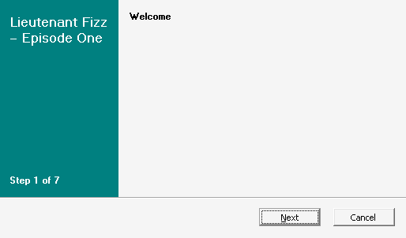
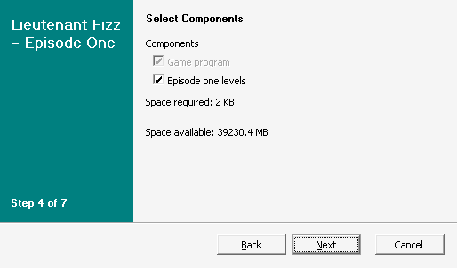
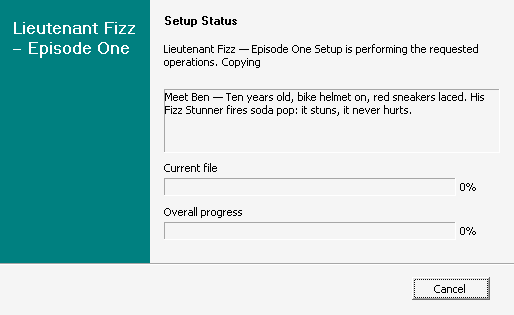

# The Win32 runtime

`liminst build -t windows-x86` turns an installer project into `SETUP.EXE` and `SETUP.LPK` for Windows 95, 98 and Me, and for every later Windows that still runs 32-bit programs. `SETUP.EXE` is Rust with no C compiler and no C library, drawn with real Windows controls, and it runs the same flow VM and installer engine as the DOS runtime ([retro-dos.md](retro-dos.md)). The decisions are D62 to D66.

## Table of contents

- [What runs on what](#what-runs-on-what)
- [Building and testing](#building-and-testing)
- [Pentium code and the prebuilt core](#pentium-code-and-the-prebuilt-core)
- [The wizard](#the-wizard)
- [Shortcuts, Add/Remove Programs and the uninstaller](#shortcuts-addremove-programs-and-the-uninstaller)
- [Files in the Windows and system folders](#files-in-the-windows-and-system-folders)
- [Startup shortcuts, command lines, a program to run first and delete at restart](#startup-shortcuts-command-lines-a-program-to-run-first-and-delete-at-restart)
- [The compiled project](#the-compiled-project)
- [What the Win32 runtime does not do](#what-the-win32-runtime-does-not-do)
- [Verification](#verification)
- [Follow-ups](#follow-ups)

## What runs on what

| Piece | Where | Is |
|---|---|---|
| `win32/setup` | Windows | `SETUP.EXE`: the `Platform` (files, drives, registry, Start menu, the wizard window) and `main`. `rt.rs` is the allocator, stack probe and 64-bit division helpers; `sys.rs` the ANSI imports; `gui.rs` the wizard; `shell.rs` COM, the registry and the folder picker |
| `crates/li-retro` | host and Windows | The flow VM (`app::run`), the installer engine, the receipt, the `Platform` and `Gui` traits and a host simulator with a scripted window (`sim::ScriptGui`) |
| `crates/li-retro-build` | host | The compiler. `compile_win32` is `compile` with long names, Start menu shortcuts and `%PROGRAMFILES%` as the default folder |
| `crates/li-lpk` | host and Windows | The `.LPK` reader `SETUP.EXE` unpacks with, and the packer the compiler writes with |
| `crates/li-cli` | host | `build -t windows-x86` (`--win32-runtime PATH`), writing `win32/`, a zip and a floppy image |

Table 1. The pieces.

`win32/` is its own Cargo workspace with its own lockfile and is not a member of the root workspace, so `make validate` needs neither `lld-link` nor `-Zbuild-std`. It reaches `li-retro` by path with `default-features = false`.

## Building and testing

```sh
win32/check.sh                     # fmt, clippy, build, then the checks on the executable below
win32/build.sh                     # win32/dist/SETUP.EXE (set CARGO_TARGET_DIR to keep the output out of the checkout)
win32/tools/wine-e2e.sh            # Lt. Fizz and Planboard installed and removed under Wine; --shots DIR saves a PNG of every page
liminst build -C examples/lt-fizz -t windows-x86 --win32-runtime win32/dist/SETUP.EXE
make win32                         # the three above, then the host tests
```

`win32/check.sh` needs the pinned toolchain with `rust-src`, `lld-link` (Debian and Ubuntu: `apt install lld`) and `llvm-objdump` (`apt install llvm`). Without `lld-link` it stops after the format and lints with a note; `WIN32_REQUIRE_TOOLS=1` makes that an error, which is how CI runs it. `wine-e2e.sh` needs `wine`, `xvfb-run`, `python3` and (for `--shots`) ImageMagick, and exits 0 with a note when they are missing.

The checks on the executable, all in `win32/tools/`:

- **`scan-pentium.sh`** disassembles `SETUP.EXE` and fails on any vector register (`xmm`, `ymm`, `zmm`, `mm0` to `mm7`), `cmov`, `emms`, `movbe`, `popcnt`, `lzcnt`, `tzcnt`, `prefetch` or fence instruction.
- **`check-imports.sh`** fails on any import that is not in `imports.allow` and on any name ending in `W`. The list is every function Windows 95's kernel32, user32, gdi32, comctl32, shell32, advapi32 and ole32 export, checked by hand against the Win32 reference, not read from a Windows 95 disk.
- **`check-pe.sh`** fails unless `file` calls it `PE32 executable for MS Windows 4.00 (GUI), Intel i386`, the subsystem and OS versions are 4.0, there are no relocations (it loads at the preferred base, as Windows 9x expects) and no C runtime DLL is imported.

The tests, in the order they cost:

- **Host unit and flow tests** (`cargo nextest run -p li-retro -p li-retro-build`, `crates/li-retro-build/tests/win32.rs`): Lt. Fizz and Planboard are compiled for `windows-x86` and run on `HostPlatform` with a `ScriptGui` in place of the keyboard. They check that the page sequence equals the DOS run of the same project (minus the sound page, which the project's own `when` limits to DOS and Windows 3.1), the files, long names, the receipt and its CRC-32s against the DOS receipt's for the shared files, the shortcut, the registry entry and its `UninstallString`, a deselected component, a typed folder, a cancel part-way (everything is removed) and an uninstall from the kept project that leaves a file the person added.
- **Goldens** (`crates/li-retro-build/tests/golden/win32/`): `GuiPage::describe` for every page of the install and the uninstall, one line per control with its text, state and enabled flag. `LI_UPDATE_GOLDEN=1` rewrites them.
- **Wine** (`win32/tools/wine-e2e.sh`): the real `SETUP.EXE` runs under Wine on Xvfb with `/PLAY` (a script that presses the real controls: `BM_CLICK` on buttons and check boxes, text set into edit controls) and `/DUMP` (the page text read back from the controls, in `describe`'s format). The dump equals the golden page for page, then the script checks the files byte for byte, the receipt's sizes and CRC-32s, the Start menu shortcut, the registry entry and its `UninstallString`, and after the uninstall that the files, the folder, the shortcut and the registry entry are gone.

## Pentium code and the prebuilt core

The prebuilt `core` for `i686-pc-windows-msvc` assumes SSE2 and uses `cmov`: its rlib has 812 `xmm` references and 618 `cmov` lines, so a stock build would fault on a Pentium, a Pentium MMX or a K6, the machines Windows 95 ran on. The build avoids it three ways:

1. **A target specification** (`win32/win32.json`): `i586-pc-windows-msvc`, CPU `pentium`, MMX, SSE and x87 off, the soft-float ABI, panic abort. Floating point is not used anywhere in the installer.
2. **`core` and `alloc` built from source** (`-Zbuild-std = ["core", "alloc", "compiler_builtins"]` with `compiler-builtins-mem`, which supplies `memcpy` and `memset`), through `RUSTC_BOOTSTRAP=1` on the pinned stable toolchain. `rust-src` is in `rust-toolchain.toml`.
3. **The scan** (`scan-pentium.sh`), which would catch a prebuilt object that slipped back in.

The build prints a warning that the `soft-float` target feature must be enabled to ensure the ABI; Rust says it will become a hard error. The target file is where it will be fixed (`win32/PROVENANCE.md`).

The link line is `lld-link` with `/NODEFAULTLIB /ENTRY:start /SUBSYSTEM:WINDOWS,4.0 /FIXED /DYNAMICBASE:NO /FILEALIGN:512`. There is no C runtime: `rt.rs` supplies the allocator (the process heap), `__chkstk` and `__aulldiv` and friends. Every import is by name from `raw-dylib` with `import_name_type = "undecorated"`, so there is no import library to find and no `...W` function. `SETUP.EXE` is about 130 KB; with a small project, `SETUP.LPK` is a few KB, and both fit one floppy.

## The wizard



Figure 1. The first page, drawn by `SETUP.EXE` under Wine (the title bar belongs to the window manager and is not in the capture).

One overlapped window, `Product Setup`, is kept for the whole run and resized to each page, as a Windows 95 wizard is. A teal banner on the left names the product and the step (`Step 4 of 7`, counted from the flow's pages). The page's heading is the layout's dialog title. The controls come from the page's compiled widgets, in tab order:

| Widget | Control |
|---|---|
| `text` | A static control, wrapped to the page width |
| `text` with `source` (the licence) | A read-only multi-line edit control with a vertical scroll bar |
| `checklist` | One check box per item; a required item is ticked and disabled |
| `radio` | One radio button per item, the first with `WS_GROUP` so the arrow keys move inside the group |
| `field`, `path` | An edit control; `install.path` gets a Browse button (`SHBrowseForFolder`) |
| `meter`, `progress` | A caption, a `msctls_progress32` bar and a percentage. A commit page whose layout names no meter gets the file and overall bars |
| `billboard` | A sunken static control that changes slide on its interval |
| `button` | `back`, `next`, `commit`, `finish`, `ok` and `cancel` go in the bar at the foot, Back and Next together and Cancel after a gap; any other action (`test`) is a push button in the page |

Table 2. Widgets and controls.



Figure 2. The components page: check boxes, the required one disabled, and the values behind the text (`Space required`, `Space available`) refreshed after every change.

A page is a plain window with `IsDialogMessage` handling the keys, so Tab, Shift-Tab, the arrows in a radio group, Space, Enter on the default button, Esc (Cancel) and the access keys (`hotkey`, underlined) work as in a dialog. Next is disabled while its `enabled_when` is false, which is how the licence page waits for a choice. Cancel and the close box ask `Exit Setup?` first, except on the last page. A bound value that changes (a typed folder, a ticked box) goes back to the flow VM as `GuiEvent::Changed`; the VM recomputes `install.size`, `system.free_space` and the rest and shows the page again, and the window updates the text in place without recreating its controls.



Figure 3. The copying page: the billboard, the current file and overall progress bars. The window keeps answering messages while files are copied, and Cancel stops and rolls back as in the DOS runtime.

The banner colour and the controls are the system's, not the theme's: `win32-classic` is the classic look and the theme only supplies the pages, their text and their order (`fizz-win95` for Lt. Fizz). The pixel art of the DOS and Studio looks is not drawn.

A page keeps all of its layout's text: each paragraph, with the values it names filled in when the page is shown, is a control in the window, in reading order, as on Windows 3.1.

Every page has the same window: the page area is 450 pixels tall (340 on a screen under 600 pixels high), so the sidebar, the page and the button row stay where they are from Welcome to Done, and a page that needs more grows the window. Tab and Shift+Tab move the focus, Space presses the focused button, check box or radio button, and Return presses the default button. `wine-e2e.sh` reads the `geometry:` lines the `/DUMP` log carries and fails when the window's rectangle changes.

## Shortcuts, Add/Remove Programs and the uninstaller

- **Shortcuts** are `.lnk` files written through `IShellLink` and `IPersistFile` (COM from `ole32`, which Windows 95 has) into `Programs\<product name>\<shortcut name>.lnk` of the current user's Start menu (D65). The calls go through hand-written vtables. Program Manager DDE was rejected because later shells half support it, and writing the `.lnk` format by hand because it has to be right for every shell version.
- **Add/Remove Programs.** `HKLM\Software\Microsoft\Windows\CurrentVersion\Uninstall\<product id>` gets `DisplayName`, `DisplayVersion`, `Publisher`, `InstallLocation` and `UninstallString`, which is `"<folder>\UNINST.EXE" /U "<folder>"`. When the machine key is closed to the account (Windows NT family, no administrator) the entry is written under the current user instead. A 32-bit program on 64-bit Windows writes below `Wow6432Node`, where Add/Remove Programs reads it.
- **The uninstaller** (D66). The install copies the running program to `UNINST.EXE` and the compiled project to `UNINST.DAT`. `UNINST.EXE /U` copies itself to the temporary folder, starts that copy with `/X /DAT` and exits, because a running executable cannot be deleted; the copy reads `UNINST.DAT`, runs the project's `uninstall` flow (the confirm page, a copying page, the done page) and removes what the receipt lists, retrying a file for a few seconds while Windows lets go of it. It then asks Windows NT to delete itself at the next restart (Windows 9x ignores that and leaves the copy in the temporary folder). `SETUP /U [folder]` from the install media works too, reading `SETUP.LPK`.
- **File types** (D87). A component's `file_types` become `FileType` operations. The install reads what `HKCR\.<ext>` names (nothing, or an empty default, or a ProgID), then writes `HKCR\<product id>.<ext>` with the type's name, `DefaultIcon` (`<exe>,0`) and `shell\open\command` (`"<exe>" "%1"`), points `.<ext>` at it and calls `SHChangeNotify(SHCNE_ASSOCCHANGED)`. `Content Type` and the old type's own keys stay as they were. The keys go to `HKEY_CLASSES_ROOT`, or to `HKCU\Software\Classes` when the account cannot write there. The uninstall puts the old owner back only while `.<ext>` still names our ProgID (a choice made since is left), deletes the extension's key when nothing owned it, and deletes the type's keys deepest first, because Windows NT's `RegDeleteKey` does not remove a key that has subkeys. A reinstall keeps what the first install replaced. The `A` record is described in SPEC §9.
- **The receipt** is the DOS runtime's `INSTALL.LIR`, with four added record letters: `A ext|prog_id|exe|previous` (a file type), `X name` (an uninstaller file below the install folder), `S path` (a shortcut file, by full path) and `R key` (the registry key). `D` records of a folder outside the install folder (the Start menu folder) are written by full path. `F` records have the same sizes and CRC-32 as the DOS receipt gives the same files.

## Files in the Windows and system folders

A component may install a file into the Windows folder or the system folder (`{windows}/` and `{system}/` in the project, `%WINDIR%\NAME` and `%SYSDIR%\NAME` in the compiled file list; D95, D97, D99). Lt. Fizz's unticked `screensaver` component installs `FIZZ.SCR` into the Windows folder, where Display Properties lists screen savers. `Win32` implements the three answers the core asks for:

- **`windows_dir` and `system_dir`** call `GetWindowsDirectoryA` and `GetSystemDirectoryA` into a 300-byte stack buffer and trim a trailing backslash. Both are on `imports.allow`; both are in the export table of the `KERNEL32.DLL` of Windows 95 OSR2 (4.00.950 C, 10 August 1996), read with `llvm-objdump -p` from the `WIN95_02.CAB` on the owner's CD image: `GetSystemDirectoryA` ordinal 404, `GetWindowsDirectoryA` ordinal 434. On Windows 95, 98 and Me they name `C:\WINDOWS` and `C:\WINDOWS\SYSTEM`. On Windows NT and later the system folder is `System32`, which a 32-bit `SETUP.EXE` on 64-bit Windows reaches as `SysWOW64`; the Windows folder is the safe place for a screen saver.
- **`copy_file`** is `CopyFileA` with `bFailIfExists` 0, and an `Error::Io` naming both paths and the Windows error on failure. The core uses it to back up a file that was there and to put it back.
- **`notice`** writes a `notice:` line to the `/DUMP` file, so a run records `backup: C:\WINDOWS\FIZZ.SCR -> BACKUP\WIN\FIZZ.SCR`. Nothing is shown on a page: no file is lost, so the person is not asked.

Writing into the Windows folder needs the rights `C:\Windows` asks for on Windows NT and later, as `C:\Program Files` does; the rest of the placing, the receipt and the uninstall are the core's (SPEC §8 and §9).

## Startup shortcuts, command lines, a program to run first and delete at restart

Four features for a product that leaves a program running (D125 to D129; SPEC sections 4 and 8). They are behind the `shell-extras` feature of `li-retro`, which this runtime enables and the DOS and Windows 3.1 runtimes do not, so those two are unchanged.

- **A shortcut in `startup`** (`Op::Link` with `startup`): a `.lnk` directly in the folder `SHGetSpecialFolderLocation(CSIDL_STARTUP)` names (`Programs\Startup` of the user's Start menu on Windows 95 and later), not in the product's Start menu folder. The receipt's `S` record is its full path, so the uninstall removes it with the others.
- **A shortcut with a command line** (`Op::Link` with `args`): `IShellLink::SetArguments`, vtable slot 11, called by hand as the other methods are.
- **`[[uninstall.pre]]`** (`Op::PreUninstall`, `U run|args|wait_ms|ignore` in the receipt): `run_program` is `CreateProcessA` with the command line `"run" args` (no application name, so a batch file goes through the command interpreter), then `WaitForSingleObject(wait_ms)` and `GetExitCodeProcess`. A wait of 0 starts it and goes on. The uninstall runs every `U` record before it removes anything, and an install over an earlier one runs the earlier receipt's before it replaces a file. A failure stops the work with the receipt still in place, so the run can be repeated, unless the record says to ignore it.
- **Delete at restart.** `remove_file` already retries a sharing violation or access denied for four seconds. When that fails the uninstall asks `MoveFileExA(path, NULL, MOVEFILE_DELAY_UNTIL_REBOOT)`, which Windows NT and later (and Wine and ReactOS) accept; if it fails and `GetVersion` says Windows 95, 98 or Me (high bit set), it adds `NUL=<short path>` to `[Rename]` in `WININIT.INI` of the Windows folder (`GetShortPathNameA`; `li_retro::install::wininit_rename` edits the text and has a host test). The folders that held only such files are asked for too (NT and later). The log gets `notice: removed at restart: <path>` for each, and the person gets one message: "1 file is still in use. Windows will remove it the next time it starts." (`report`, a message box, or a `report:` line in a `/DUMP` run).
- **Imports.** `GetExitCodeProcess`, `GetShortPathNameA`, `GetVersion` and `WaitForSingleObject` joined `win32/tools/imports.allow`; all four are in the export table of Windows 95's `KERNEL32.DLL`. `MoveFileExA` was already there (the uninstaller's own temporary copy uses the same restart removal).
- **Compiled format.** `Op::Link` and `Op::PreUninstall` need format 6; the compiler writes 6 only for a project that has one of them, so every other project is byte for byte what it was.
- **Example and test.** `examples/startup-helper` has all four, and `wine-e2e.sh` installs it, holds `HELPER.LOG` open from a second `SETUP.EXE` (its `/DUMP` file is opened without sharing for delete, so the delete is refused), uninstalls, and checks that `STOP.BAT /quit` ran first with the product's files still there, that `HELPER.LOG` is on `PendingFileRenameOperations`, that every other file, all three shortcuts and the registry entry are gone, and what the person was told.

## The compiled project

The compiled project is `li-retro`'s `Project`, format version 5 (4, 3 and 2 are still read; the host and this runtime also read 6, see above). Version 6 adds `Op::Link` and `Op::PreUninstall`. Version 5 lets a file's destination start with `%WINDIR%` or `%SYSDIR%`. Version 4 adds `Component.default` and `Project.owners` (see [retro-dos.md](retro-dos.md)). Version 3 adds `Op::FileType`. Version 2 added `Screen.title` (the dialog title, which the text runtime has in the border cells) and `FileEntry.stored`. The Win32 flavour differs from DOS in what `compile_win32` does:

- A target must use the `win32-classic` renderer and the id `windows-x86` for `liminst build`.
- Destinations keep their case and length and may have spaces. The pack stores each file under a generated 8.3 name (`F0000001` and on) with the real path as its long name (D64); `liminst lpk list` shows both.
- The default folder is `%PROGRAMFILES%\<product name>`, which the runtime resolves from `ProgramFilesDir` in the registry at start.
- A `shortcut` becomes a Start menu shortcut, not a batch launcher; `detect-sound` is skipped with a warning (the example's sound page is limited to `tui-retro` and `win16` by its own `when`).
- Layout overrides are looked up for `win32-classic`, then `tui-retro`, then `tui`.
- The pack's target mask is `WIN32`.

`SETUP.EXE` reads the pack through `li-lpk` as the DOS runtime does, one chunk at a time in a 32 KiB window and checking each chunk's CRC-32 before it is written.

## What the Win32 runtime does not do

- **No Lua.** Scripts are out of scope, as for DOS (D41): a step may name only a `builtin:` action, and `check-disk-space` works. `check-feed` and `launch-app` are skipped.
- **One folder, or the two Windows ones.** Every file goes below `{install}`, except a file placed directly in the Windows or system folder (see above); no folder is made or removed below those. URL schemes and `PATH` entries are reported at build time and skipped.
- **No update, modify, repair or launch.** Only install and uninstall. The receipt has the CRCs repair needs.
- **"Launch after setup"** on the last page is a check box that does nothing yet.
- **No disk spanning**, as for DOS: the runtime reads volume 1 of `SETUP.LPK`.
- **ANSI only.** Names are converted with the machine's ANSI code page, so a name the code page lacks becomes `?`. Windows 2000 and later with a non-Latin system locale will show those characters wrong; the Unicode file APIs are not in Windows 95.
- **No visual styles or high-DPI manifest**, and the banner is a fixed teal.
- **No uninstaller on a read-only or removed install folder**: Add/Remove Programs shows the entry, and running it reports the missing file.

## Verification

- **Host:** the tests above run on every `cargo nextest run --workspace`.
- **CI** (`Win32 runtime`): the host tests, `win32/check.sh` with `WIN32_REQUIRE_TOOLS=1`. The Wine run is local.
- **Wine** (Wine on Xvfb, 64-bit prefix): both examples installed and uninstalled, pages equal to the goldens. A last run ticks Lt. Fizz's screen saver over a `FIZZ.SCR` seeded in `C:\windows`: the new file is there, the seeded bytes are in `BACKUP\WIN`, the receipt has the `F` and `O` records (its CRC check reads a full path through the prefix's `drive_c`, ignoring case) and the log has the `backup:` line; after the uninstall the seeded bytes are back and the install folder is gone.
- **Not verified:** the real Display Properties list on Windows 95, 98, Me and 10; a 32-bit saver in `SysWOW64` on 64-bit Windows; the elevation prompt for `C:\Windows` on Windows Vista and later; a Windows folder on another drive or a UNC path.
- **Windows Me** (the `Windows ME` virtual machine): not yet run. The machine was in use when this was written, so the check is pending. The procedure, with the rules in the virtual machine notes (take a snapshot first, set the audio driver to none while testing and put it back, never build Rust in the guest, restore the snapshot after):
  1. `liminst build -C examples/lt-fizz -t windows-x86 --win32-runtime win32/dist/SETUP.EXE -o /tmp/out`, then put `win32/` and a copy of `win32/tools/me-play.txt` on the shared folder or a floppy image (`lt-fizz-1.0.0-windows-x86-1440.img`).
  2. In the guest run `SETUP.EXE /PLAY ME-PLAY.TXT /DUMP DUMP.TXT /SHOT C:\SHOTS` and compare `DUMP.TXT` with the golden; then run it by hand with the mouse, and remove the product from Add/Remove Programs.
  3. Restore the snapshot.

## Follow-ups

- Run it on the Windows Me machine, on Windows 95 and 98 if a machine or image is available, and on 64-bit Windows 11.
- The launch-after-setup box, a repair command and `launch`, URL schemes and the shell verbs beyond `open`, and a per-machine install with an administrator prompt.
- A `.res` with an icon and version information, and an optional manifest for visual styles that keeps the 95 look off.
- A Unicode path for Windows NT: `...W` imports behind a runtime check, so a name outside the ANSI code page survives.
- Draw the theme's art in the banner from the compiled layout.
